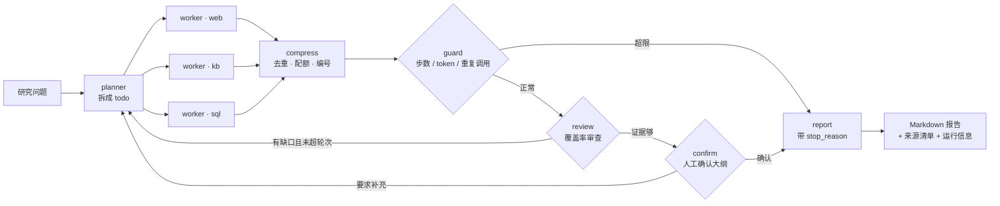

# 物流研究助手 Research-Agent

> 面向**物流与供应链行业**研究型问答的多智能体深度检索系统：自己拆解子任务 → 三路并行取证 → 有界审查补检 → 交出带引用的报告。


---

## 关于这个仓库

**履约知识助手是一个完整可运行的 RAG 知识库系统，可按本文档在本地部署复现。** 要点：

- 检索主链路基于 LangGraph 编排：多格式文档导入 → 三路混合召回 → RRF 融合 → 精排 → SSE 流式问答。
- 自带一套离线评测体系（`eval/`）：六组策略消融、配对 bootstrap、全局检索对照与标注集构建工具。
- **评测数字都是实际跑出来的**，`eval/results/` 与 `eval/README.md` 里有对应的报告与复现命令，任何人都能按文档复跑核对。

## 目录

- [这是什么](#这是什么)
- [与另外两个项目的关系](#与另外两个项目的关系)
- [架构](#架构)
- [六个环节各管什么](#六个环节各管什么)
- [三路取证](#三路取证)
- [几个刻意的设计取舍](#几个刻意的设计取舍)
- [快速开始](#快速开始)
- [使用方式](#使用方式)
- [评测](#评测)
- [接口契约](#接口契约)
- [目录结构](#目录结构)
- [实测数据](#实测数据)
- [已知限制](#已知限制)
- [Roadmap](#roadmap)
- [开源协议](#开源协议)

---

## 这是什么

输入一句研究型问题（"各仓出库时效与妥投率排名如何"/"这个型号的电动叉车日常怎么保养"/"今年冷链仓储的行业政策有哪些变化"），系统会：

1. **规划**：把问题拆成若干可独立取证的子任务，并给每个子任务标好走哪几路；
2. **并行取证**：联网搜索、内部知识库、结构化数据三路同时开工，每路产出结构化的**证据卡片**；
3. **汇聚压缩**：去重、按路配额、编号、预算截断；
4. **守卫**：步数 / token / 重复调用三重闸门，超限就带已有证据收尾，而不是崩掉；
5. **审查**：逐项比对子任务覆盖率，证据不足且还有轮次额度就回炉补检索（最多 2 轮）；
6. **人工确认**：报告动笔前把大纲交给你过一遍，可以写意见让它再去查；
7. **报告**：Markdown 正文 + 由代码拼装的来源清单与运行元信息。

它不是"RAG 问答"：检索不是终点，**证据的组织方式**才是这个项目的重点。

## 与另外三个项目的关系

```
履约知识助手 Warehouse-KB（管文档）     文档解析 · 切片 · Milvus 向量 · 混合检索 · 重排
        ▲  POST /retrieve
        │
物流研究助手 Research-Agent（管编排）  ─────┼─────  百炼 MCP WebSearch（管公开信息）
        │
        ▼  POST /api/query
仓配自助问数 LogiQL（管数据）      自然语言 → SQL · 元数据仓库 · 结果集
```

物流研究助手**不直连任何存储**，三路取证全部走 HTTP：

| 路由 | 实际后端 | 为什么这么做 |
| --- | --- | --- |
| `web` | 百炼 MCP WebSearch | 免掉境外 API 与额外 key |
| `kb` | 履约知识助手 `POST /retrieve` | 仓储装备手册知识库的向量是 BGE-M3（1024 维）建的，要检索就得用同模型编码，等于把 torch + FlagEmbedding 再装一遍（数 GB） |
| `sql` | 仓配自助问数 `POST /api/query` | NL2SQL 的难点是「从 32 张仓配履约表里挑对字段」，那是仓配自助问数元数据召回链路的活，不该重写 |

这样做的副作用是好的：**任一后端挂掉就是一次真实的降级演练**，而不是整条链路崩溃。

上面三个都是「查信息」，第四个 [履约客服助手 Fulfill-Bot](https://github.com/winc-0/fulfill-bot) 做的是「办事」：
YAML 流程 DSL 定义业务流程，对话状态机管住中断挂起/恢复/取消，三条轨道分流任务、知识问答与闲聊，
动作失败即终止流程。它和物流研究助手没有调用关系，只是同一套企业落地场景里的并列解法——物流研究助手输出报告，履约客服助手把事办完。

| 项目 | 解决的问题 | 形态 |
| --- | --- | --- |
| 履约知识助手 Warehouse-KB | 文档里有什么 | 一次检索 |
| 仓配自助问数 LogiQL | 数据里有什么 | 一句 SQL |
| 物流研究助手 Research-Agent | 公开信息里有什么 | 一份带引用的报告 |
| 履约客服助手 Fulfill-Bot | 用户的要求办成没有 | 一段多轮任务 |

## 架构



`confirm` 是 LangGraph `interrupt()` 的挂起点，必须配 checkpointer：挂起时把状态存住，用户确认后用 `Command(resume=...)` 从断点续跑。

## 六个环节各管什么

| 环节 | 职责 | 关键约束 |
| --- | --- | --- |
| `planner` | 输出结构化 todo（问题 + 路由） | 禁止臆测年份 / 地区 / 品类 / 口径；解析失败降级为"单任务三路全上" |
| `workers` | 三路并行取证 | 同一 (路, 归一化问题) 只打一次；失败三级降级：重试 → 换路 → 标记缺失继续 |
| `compress` | 去重 → 按路配额 → 编号 → 预算截断 | 先全局去重再分配额，否则重复项白占配额 |
| `guard` | 三重闸门 | 命中不抛异常，带已有证据收尾并在报告里注明 |
| `review` | 覆盖率审查 + 决定是否回炉 | 有界：`REVIEW_MAX_ROUNDS`（默认 2）；先规则过滤再让模型判断 |
| `confirm` | 报告前的人工确认 | 超时（默认 600s）按"确认"放行，不把会话永久悬住 |
| `report` | 正文 + 引用脚注 + 运行信息 | 来源清单与元信息由**代码**拼装，不让模型写（它会改写 URL、编数字） |

## 三路取证

统一的证据卡片（`app/tools/base.py`）是整条链路的地基——没有它，去重、引用编号、"这句话有没有证据支持"都无从谈起：

```python
Evidence(source="kb", claim="…", snippet="…", ref="手册.pdf#p12", confidence=0.83)
ToolResult(source="sql", ok=False, error="Unknown column", retryable=False)
```

`retryable` 存在的理由很实际：超时、连接中断、5xx 值得重试；"字段不存在""SQL 语法错误"这类确定性失败重试一次结果完全一样，白等 20 多秒。

## 几个刻意的设计取舍

1. **不用一行式的 agent 框架**。`create_deep_agent` 之类把职责、阈值、降级路径都封在黑盒里，既没法调也没法评测。自己搭图之后，六块各自可单测、可开关、可做消融。
2. **并行字段一律带 reducer**。`evidences / calls / guard_trips` 都是 `Annotated[list, operator.add]`；三路 worker 同时写覆盖型字段会丢数据，这是 LangGraph 并行节点唯一的正确写法。
3. **todo id 由代码重编**（`r{轮次}t{序号}`），不采信模型给的值。回环时模型会沿用上一轮的 `t1`，两轮串号后证据归属就乱了。
4. **状态里只放可序列化的事实**，不放连接、不放客户端——这样中间状态能落盘、回放，评测脚本可以逐字段比对。
5. **每问一次换断点 id**（`{thread_id}:{run_seq}`）。否则第二个问题会顺着上一个 checkpoint 走，`operator.add` 的证据跨轮累加串场。
6. **CLI 强制关掉 HITL**。命令行没人盯着，挂起等确认等于卡死；确认是 Web 才有的能力。

## 快速开始

### 0. 前置

| 依赖 | 说明 |
| --- | --- |
| Python 3.11 / 3.12 | 3.13 未验证（部分依赖尚未发轮子） |
| Node 18+ | 只跑前端时需要 |
| 百炼 API Key | LLM 与 WebSearch MCP 共用 |
| 履约知识助手服务 `:8001` | 提供 `POST /retrieve`，不启动则 `kb` 路失败 |
| 仓配自助问数服务 `:8010` | 提供 `POST /api/query`，不启动则 `sql` 路失败 |

两个依赖服务各自启动（在各自仓库里）：

```bash
# 履约知识助手：检索服务
python -m web.api.query_service          # → 127.0.0.1:8001

# 仓配自助问数：问数服务
uvicorn main:app --port 8010 --env-file .env   # → 127.0.0.1:8010
```

> 依赖服务不可达时物流研究助手仍能跑，只是对应那一路会按降级路径标记缺失——这是设计如此，不是故障。

### 1. 安装

```bash
cd Research-Agent
python -m venv .venv
.venv/Scripts/python -m pip install -e .        # Windows
# source .venv/bin/activate && pip install -e .  # macOS / Linux
```

> 若 pip 源被镜像站限流，加 `-i https://pypi.org/simple` 直连官方源。

### 2. 配置

```bash
cp .env.example .env
# 填 LLM_API_KEY / MCP_API_KEY（可同一个）
```

### 3. 一键启动（后端 + 前端）

```bash
.venv/Scripts/python scripts/dev.py
```

脚本会先做体检（`.env` 是否存在、key 是否还是占位符、`:8001` / `:8010` 是否可达、前端依赖是否装好），
再拉起服务，`Ctrl+C` 一起退出：

- 物流研究助手后端 → <http://127.0.0.1:8000>（文档 <http://127.0.0.1:8000/docs>）
- 前端界面 → <http://127.0.0.1:5173>

只起后端：`python scripts/dev.py --no-frontend`；跳过体检：`--skip-check`。

### 4. 手动启动（等价方式）

```bash
.venv/Scripts/python -m app.api.server                 # 后端 :8000
cd frontend && npm install && npm run dev              # 前端 :5173
```

## 使用方式

**Web**：打开 <http://127.0.0.1:5173>，提问 → 展开"查看研究过程"看每一步 → 大纲面板上确认或写意见补充检索 → 下载报告。

**CLI**：

```bash
.venv/Scripts/python -m app.agent.run "各仓出库时效与妥投率排名如何"
.venv/Scripts/python -m app.agent.run "问题" --quiet        # 只输出报告正文
.venv/Scripts/python -m app.agent.run "问题" --save out.md  # 报告落盘
```

**自检**：

```bash
.venv/Scripts/python scripts/check_tools.py    # 三路工具连通性（web / kb / sql 各打一次）
.venv/Scripts/python scripts/smoke_web.py       # 走 WS + REST 的端到端冒烟（会真实跑一轮）
.venv/Scripts/python -m unittest discover -s tests -v   # 76 项离线单测，不调 LLM
```

## 评测

`eval/` 是一套**编排层消融**：取证只录一次落盘，六组策略回放同一份证据池——
证据完全相同，差异只能来自编排。40 题分五层（单源知识库 12 / 单源数仓 12 / 多子任务 8 / 需联网 4 / 不可答 4）。

```bash
.venv/Scripts/python -m eval.run_eval record   # 录制证据池（真实调用，约 25 分钟）
.venv/Scripts/python -m eval.run_eval replay   # 六组回放 + 判分（约 22 分钟）
.venv/Scripts/python -m eval.run_eval report   # 重新出表
```

| 组别 | 关键事实命中 | 段落引用覆盖 | 平均 token | 平均工具调用 |
| --- | --- | --- | --- | --- |
| G1 单智能体一把梭 | 90.1% | 66.7% | 4676 | 3.00 |
| **G2 +多子任务规划** | **91.7%** | 74.6% | 4007 | 2.48 |
| G3 +跨源去重 | 89.1% | 83.3% | 2706 | 2.48 |
| G4 +按路配额 | 84.9% | **85.8%** | **2547** | 2.48 |
| G5 +审查回环（完整） | 88.0% | 75.0% | 4843 | 5.40 |
| G6 完整但关掉去重 | 91.7% | 77.9% | 5627 | 5.33 |

四个结论：

- **多子任务规划是唯一在事实命中上为正的一级**（+1.6 个点），token 同时还降了 14%。
  复合层 8 题（一问三件事）事实命中 87.5%，说明拆分确实有效。
- **去重与配额是用准确率换 token**：两级合计把平均 token 从 4007 压到 2547（−36%），
  事实命中累计掉 6.8 个点；换来的是段落引用覆盖从 74.6% 涨到 85.8%。
  看「答得全不全」选 G2，看「每段有没有出处」选 G4。
- **审查回环把去重丢掉的分救回一半**（84.9% → 88.0%），代价是 token +90%、
  工具调用从 2.48 涨到 5.40。
- **留一法翻了面**：G6（其它都在、只抽掉去重）反而拿到 91.7%，比完整链路 G5 高 3.7 个点。
  说明在这批题上，去重这层的收益并不像累加式消融看起来那么确定。

需要说明：换到仓储物流语料后完整链路（G5）不再是指标最高的那组——
这批单源题的期望值集中在同一份手册里，三路全上的 G1 天然就能撞对。
这个结果如实记录，没有为了好看挑组。

不可答层 4 题全部明确承认「查不到」，没有编数字；需联网层 4 题诚实性满分。
详细口径、逐级贡献与局限见 [`eval/README.md`](./eval/README.md)。

### 判分器的已知偏差（重要）

上表的「关键事实命中」「段落引用覆盖」两列是 **LLM-as-judge** 打的分，而当初那一轮跑的时候，
判分模型和被测主链**是同一个**（都是 `qwen-flash`，见 `eval/results/full/meta.json` 的
`judge_same_as_main: true`）。这带来两个问题：

1. **自我偏好偏差**：同族模型倾向给同族输出更高分，绝对值可能系统性偏高。
2. **判分器能力不足**：0~2 分三档 rubric 要判断「关键事实是否被覆盖」，最便宜的档位做这种
   判别，噪声可能比 6 个点量级的组间差异还大。

已做的改动：把判分模型拆成独立配置 `LLM_JUDGE_MODEL_NAME`（默认 `qwen-plus`），
不再跟随被测模型；`meta.json` 里新增 `judge_same_as_main` 字段留痕，
跑的时候如果两者相同会直接在控制台告警。

**还没做的**：用 `qwen-plus` 重跑一轮，以及抽 10 题做人工复核报「judge-human 一致率」。
所以上表应当读作「**同一判分器下的相对比较**」——组间谁高谁低比绝对值可信，
但「90.1%」这个绝对水平没有独立验证过。

## 接口契约

前端是一套独立的 Vue 3 + Vite 界面，只通过下面这些接口与后端耦合，换掉前端不需要动后端。

| 方法 | 路径 | 说明 |
| --- | --- | --- |
| `POST` | `/api/task` | `{query, thread_id}` → `{thread_id}`，异步启动一轮研究 |
| `POST` | `/api/confirm` | `{thread_id, decision: approve\|revise, feedback}`，恢复挂起的图 |
| `GET` | `/api/files?path=` | 列出会话工作区文件 |
| `GET` | `/api/download?path=` | 下载文件（只允许工作区内的路径） |
| `POST` | `/api/upload` | multipart，附件落到会话目录 |
| `GET` | `/api/health` | 存活探针（会话数 / 工作区路径） |
| `GET` | `/outputs/...` | 报告静态访问 |
| `WS` | `/ws/{thread_id}` | 事件流 |

WebSocket 事件共六类（前五类是基础契约，`confirm_required` 是人工确认新增的），节点动作全部翻译成它们：

| 事件 | 载荷 | 前端表现 |
| --- | --- | --- |
| `session_created` | `{path}` | 打开右侧文件栏 |
| `tool_start` | `{tool_name, args}` | 研究过程里加一行"调用工具" |
| `assistant_call` | `{assistant_name, args}` | 加一行"助手" |
| `confirm_required` | `{outline, evidence_total}` | 弹出大纲确认面板，图在此挂起 |
| `task_result` | `{result}` | 渲染最终报告 |
| `error` | 顶层 `message` | 系统提示（注意文案在顶层，其余在 `data` 里） |

同一 `thread_id` 开多个页面时事件会广播给全部连接，不是谁先连谁独占。

## 目录结构

```
Research-Agent/
├── app/
│   ├── agent/
│   │   ├── graph.py          # 主图装配与条件边
│   │   ├── state.py          # 共享状态（累加字段带 reducer）
│   │   ├── llm.py            # 模型调用 + JSON 抽取（花括号配平扫描）
│   │   ├── prompts.py        # 提示词加载（prompts/*.md 的 ${var} 占位）
│   │   ├── run.py            # CLI 入口
│   │   └── nodes/            # planner / worker / compress / guard / review / confirm / report
│   ├── tools/                # base（证据卡片契约）/ web_search / kb_retrieve / sql_query
│   ├── api/server.py         # FastAPI：REST + WebSocket + 静态报告
│   ├── core/                 # 事件总线（ContextVar）/ 日志 / 文本工具
│   └── conf/settings.py      # dataclass 配置
├── prompts/                  # planner.md / review.md / report.md
├── frontend/                 # Vue 3 + Vite 界面
├── scripts/                  # dev.py（一键启动）/ check_tools.py / smoke_web.py
├── tests/                    # test_pipeline.py 主链路 49 项 + test_eval.py 评测口径 27 项
├── output/                   # 会话工作区（git 忽略）
└── eval/                     # 编排层消融：题库 / 录制 / 回放 / 判分 / 报表
```

## 实测数据

单机、qwen-plus、履约知识助手/仓配自助问数都在同机运行：

| 场景 | 耗时 | LLM 调用 | 子任务 | 备注 |
| --- | --- | --- | --- | --- |
| 一次确认直接出报告 | 20.7s | 1 | 1 | 单源可答的问题 |
| 提意见后补充检索 | 96.9s | 7 | 5 | 含第二轮规划 + 二次确认 |
| 跨源问题 | — | — | — | 35 条原始证据 → 去重后 24 → 入选 14 |

40 题 × 6 组消融的数字见上一节；录制阶段实测 384 次取证调用、993 条证据、编排 29.2 万 token，整轮成本在十元以内。

## 已知限制

- **评测样本量有限**：40 题分五层，每层 4~12 题，层内几个百分点的差异不足以当结论；
  且只覆盖「仓储装备手册 + 仓配履约数仓」两类语料，不能外推到开放域研究。
- **语料与数据不同域**：履约知识助手的语料是仓储物流装备手册，仓配自助问数的数仓是仓配履约数据。跨源问题里必有一路空，这是数据现实而非代码缺陷，评测要按「单源可答 / 双源可查 / 跨源核查」分层出题。
- **checkpointer 是内存版**：进程重启后挂起的会话丢失，要跨重启续跑需换 `SqliteSaver`。
- **无鉴权**：`:8000` 无任何认证，能访问端口的人即可发起研究并读取工作区文件（文件读取已限制在工作区内，但服务本身应只监听本机）。
- **没有容器化**：不提供 Dockerfile / compose，依赖服务需要各自起。
- **单机演示定位**：会话状态、订阅者集合都在进程内，不是多副本可部署的形态。
- **web 路依赖百炼 MCP 的可用性**，且搜索结果不做正文抓取，只用标题 + 摘要。

## Roadmap

- [x] P0 骨架与三路取证工具（含统一证据契约、连通自检）
- [x] P1 七节点主图（plan / workers / compress / guard / review / confirm / report）+ 守卫 + 有界审查回环 + 49 项离线单测
- [x] P2 Web 服务层、前端界面、HITL 人工确认
- [x] 前端换肤（自有图标与配色，去掉原版视觉）
- [x] **P3 评测**：40 题五层题库 + 6 组消融（单智能体 → +规划 → +去重 → +配额 → +审查，另加去重留一法），
      指标为关键事实命中 / 引用有效率 / 段落引用覆盖 / 路由命中 / 忠实性 / 覆盖度 / 诚实性 / token / 调用次数
- [ ] P4 发布：GitHub 公开仓库、架构图与演示数据、可复现的一键启动说明
- [ ] 可选：`SqliteSaver` 持久化、报告 PDF 导出、web 路正文抓取

## 开源协议

[MIT](./LICENSE) © 2026 Wu Jingchao
